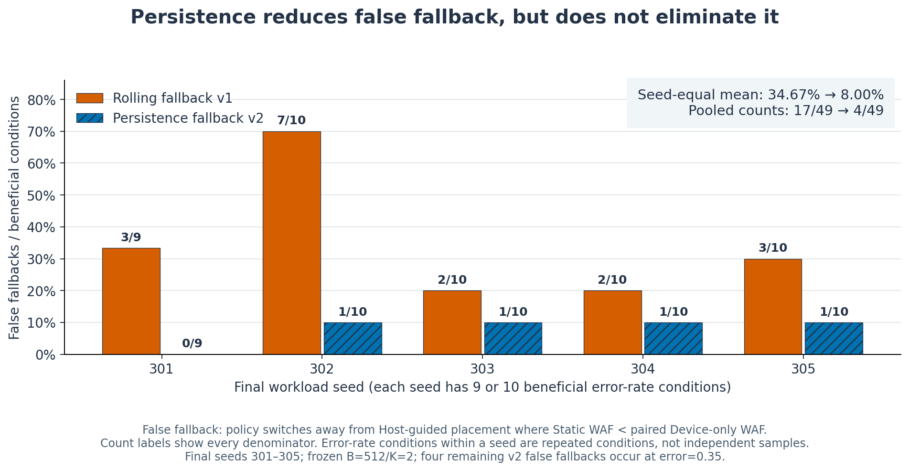

# Host Hint Safe Fallback

A controlled FTL study of when imperfect placement hints should stop being trusted.

**Observation:** in the archived final protocol, persistence-aware v2 reduced seed-equal beneficial false fallback **34.67% → 8.00%**. It timely detected **21/21 harmful conditions** and lowered WAF against Static in all 21, while **erase-count CV increased in all 21**.



*Synthetic, stationary 50k-write workloads; five final workload seeds. Seventy paired error-rate conditions are not seventy independent samples. This is a mechanism study, not real NVMe FDP, hardware latency or device-life evidence.*

[Quick start](#quick-start) · [Methodology](docs/METHODOLOGY.md) · [Results and figures](docs/RESULTS.md) · [Reproducibility](docs/REPRODUCIBILITY.md) · [Limitations](docs/LIMITATIONS.md)

[Executed validation and CI](docs/VALIDATION_STATUS.md)

## Quick start

Python 3.14.6 is the rebuild's tested simulator runtime; only the standard library is required.

```sh
python3 reproduce.py verify
python3 reproduce.py tests
python3 reproduce.py smoke
```

Run inside this repository. The smoke uses separate seeds and does not rerun or retune the final holdout. Production final requires the preserved original Git history and frozen selection; [reproducibility](docs/REPRODUCIBILITY.md) distinguishes that historical replay from a new untouched validation.

## Background and research question

Host knowledge can improve placement, but a wrong label may destroy useful lifetime segregation. When does Static become worse than Device-only, and can the device detect persistent separation loss using already resolved past lifetimes?

The first hypothesis—higher binary error always worsens WAF—failed. With symmetric placement groups, 100% SHORT/LONG inversion can preserve segregation by swapping the names. The revised detector observes label-invariant `|phi|` association, not semantic label accuracy.

## Implementation and protocol

Device-only classifies from resolved lifetimes. Static always trusts the host. v1 falls back on a rolling signal; v2 requires two consecutive BAD, non-overlapping 512-pair evidence blocks before switching to device-side placement. It does not migrate all existing data or claim a new lifetime predictor.

| Frozen item | Value |
|---|---|
| Lifetime boundary | 451 host writes |
| Association threshold | 0.29980003993028376 |
| Min marginal support | 5 |
| Detector | B=512, K=2 |
| Splits | calibration 1–3; v1 held-out 101–105; development 201–205; final 301–305 |
| Final workload | 50,000 writes, 2,048 logical pages, 14 corruption rates |

B/K was selected on development and frozen before final. [Architecture](docs/ARCHITECTURE.md) · [Source map](docs/FILE_MAP.md) · [Historical final report](FINAL_REPORT.md) · [Frozen source hashes](FROZEN_SOURCE_SHA256.json)

## Results and failure cases

- Harmful: 21/21 timely detection and lower WAF than Static. Median relative WAF change −1.08%; median recovered absolute WAF 0.02952.
- Beneficial false fallback: pooled **17/49 → 4/49**. The headline **34.67% → 8.00%** averages five seed rates equally; pooled denominators give different percentages.
- All four remaining false fallbacks occur at error 0.35. That boundary contains one harmful and four beneficial final conditions.
- Harmful erase-count CV: median absolute change **+0.02871**. Lower WAF is accompanied by worse wear balance.

[All figures, data links and captions](docs/RESULTS.md) show the symmetry counterexample and trade-off alongside the improvement. No threshold is retuned in this rebuild.

## My contribution

Research records attribute problem framing, conditions, freeze decisions, validation and interpretation to Changyeop Lee; Codex implemented code/tests and ChatGPT assisted mathematical review. This rebuild adds reproducibility tooling and documentation. [Contribution evidence and limits](docs/CONTRIBUTIONS.md).

## Future work and related research

Test change points, stale hints, unequal placement budgets, broader traces and wear-aware recovery under a new protocol. The earlier [Online Hot/Cold FTL](https://github.com/brightlcy/online-hotcold-ftl) measures placement from recent writes on real trace extracts. Both share implementation ancestry; their datasets, policies and WAF intervals differ.

한국어 요약: hint 정답률보다 실제 수명 분리력이 중요했습니다. 지속성 검출은 오전환을 줄였지만 경계조건의 오판과 wear imbalance 비용이 남았습니다.
