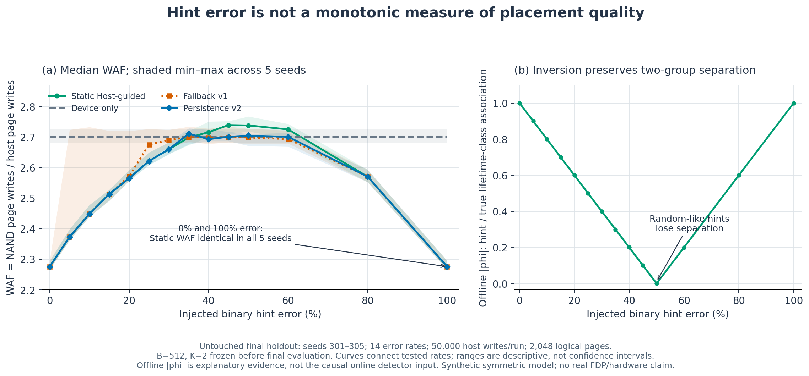
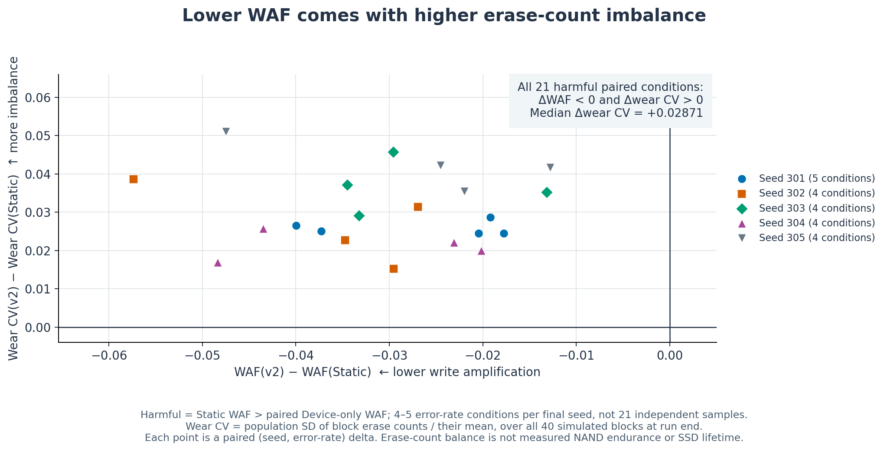

# Figure evidence and regeneration

These three figures use the **untouched final holdout**, seeds 301–305, from the archived August 2026 experiment. October 2026 work validates and replots those results. No final experiment, threshold selection, or detector retuning is performed by the figure generator.

## Figure plan and claims

| Figure | Claim supported by the data | Evidence |
|---|---|---|
| [Hint-error symmetry, PNG](../figures/rebuild_hint_error_symmetry.png) · [SVG](../figures/rebuild_hint_error_symmetry.svg) | Semantic error is not a monotonic placement-quality signal in this symmetric binary model: Static WAF is identical at 0% and 100% error in every final seed. | Archived final per-run WAF and offline association values; [condition CSV](../results/final_summary/final_condition_outcomes.csv). |
| [False fallback, PNG](../figures/rebuild_false_fallback.png) · [SVG](../figures/rebuild_false_fallback.svg) | Frozen persistence v2 reduces beneficial-condition false fallback relative to v1, while four boundary-adjacent false fallbacks remain. | [Seed-level CSV](../results/final_summary/final_seed_summaries.csv), validated against per-condition and per-run data. |
| [WAF/wear trade-off, PNG](../figures/rebuild_waf_wear_tradeoff.png) · [SVG](../figures/rebuild_waf_wear_tradeoff.svg) | In all 21 harmful final conditions v2 lowers WAF relative to Static and increases block erase-count CV. | [Paired trade-off CSV](../results/final_summary/final_tradeoff_summary.csv), independently recomputed from archived runs. |

### Figure 1 — Error, WAF, and label symmetry



**Caption.** At each of 14 injected binary hint-error rates, lines show the median and shaded regions show the minimum–maximum across five final workload seeds. Device-only is cached once per workload seed and is reused across error rates. Static, v1, and v2 share the same workload and hint realization within each `(seed, error rate)` condition. WAF is total simulated NAND page writes divided by 50,000 host page writes over the complete run, with no warm-up excluded. Lines connect tested rates rather than fitted predictions. Shaded ranges describe these five seeds and are not confidence intervals. The WAF axis is explicitly limited to the observed comparison region; it is a line chart, not a zero-origin bar chart.

At 0% and 100% error, the Static WAF values are identical within each seed: 2.27570, 2.29486, 2.28078, 2.27306, and 2.26646. Full inversion exchanges group names while retaining separation. Near 50% error, offline association approaches zero and Static WAF is worse than the paired Device-only WAF. This is a counterexample to monotonic degradation with semantic error in this model.

The right panel uses `offline_hint_absolute_phi`, computed from the synthetic workload's true short/long class and host label. **It is explanatory oracle evidence, not the online detector input.** The causal online detector uses already resolved lifetimes. A favorable offline curve does not by itself validate online detection or real FDP behavior.

### Figure 2 — False fallback with visible denominators


**Caption.** False fallback means a switch away from Host-guided placement in a condition where the full-run Static WAF is lower than its paired Device-only WAF. This offline condition label is an evaluation oracle and is not available to the deployed detector. Each bar label shows false fallbacks / beneficial conditions for one seed. Seeds have 9 or 10 beneficial error-rate conditions. The five seed rates receive equal weight in the primary mean. Counts pooled over error rates are reported separately.

| Seed | Beneficial conditions | v1 false fallback | v2 false fallback |
|---|---:|---:|---:|
| 301 | 9 | 3/9 | 0/9 |
| 302 | 10 | 7/10 | 1/10 |
| 303 | 10 | 2/10 | 1/10 |
| 304 | 10 | 2/10 | 1/10 |
| 305 | 10 | 3/10 | 1/10 |
| Seed-equal mean | 5 seeds | 34.6667% | 8.0000% |
| Pooled count, descriptive | 49 conditions | 17/49 (34.6939%) | 4/49 (8.1633%) |

The seed-equal relative reduction is 76.9231%; it must not be confused with a 26.67% relative reduction or with the slightly different pooled ratio. Remaining v2 false fallbacks all occur at error=0.35. There are five independent workload seeds in the final design; the 70 seed/error-rate pairs, 49 beneficial conditions, and 21 harmful conditions are repeated within-seed conditions, not 70/49/21 independent stochastic samples.

**Interpretation.** Persistence reduces false switches in this controlled stationary setup. It does not eliminate them. It also reacts later: among the harmful conditions, descriptive median trigger indices are 453 host writes for v1 and 1,353 for v2. These are host-write positions from a stationary run, not measured time after a clean→degraded change point.

### Figure 3 — WAF and wear-balance trade-off



**Caption.** Each point is a paired v2-minus-Static change for a `(seed, error rate)` condition classified as harmful because Static WAF exceeds paired Device-only WAF. Five seed-specific marker shapes identify 4–5 harmful conditions each. Negative x is lower WAF; positive y is higher erase-count imbalance. All 21 points have both signs. Median wear CV change across these retained conditions is +0.0287097. No significance test or population-level confidence interval is claimed for the correlated within-seed points.

Wear CV is `population standard deviation(block erase counts) / mean(block erase counts)` across all 40 simulated blocks at run end, including zero-erase blocks. It measures spatial balance of accumulated simulated erases. It is not NAND program/erase endurance, device reliability, or SSD lifetime.

**Interpretation.** v2 improves the WAF/GC/migration side of this comparison while worsening erase-count balance. The title “safe fallback” must not be interpreted as improving every metric or guaranteeing no false fallback. Median WAF harm recovered relative to Static is 0.02952 for v2 versus 0.02790 for v1 across harmful conditions; recovery is a WAF difference, not a percentage or endurance result. The unchanged archived output reports 21/21 timely detections, 21/21 WAF improvements versus Static, and 13/21 conditions reaching or beating Device-only WAF. Those are descriptive condition counts with five seed-level final gates.

## Frozen evaluation conditions

| Item | Archived final value |
|---|---|
| Workload | Controlled stationary synthetic lifetime workload |
| Final seeds | 301, 302, 303, 304, 305 |
| Host writes per policy run | 50,000 single-page writes; full-run evaluation |
| Logical / physical pages | 2,048 / 2,560 |
| Geometry | 4 KiB pages; 64 pages/block; 40 blocks; 4 simulated chips |
| Actual OP | 20% of physical capacity |
| GC threshold / reserve | 128 pages / 2 blocks |
| Error-rate grid | 0, .05, .10, .15, .20, .25, .30, .35, .40, .45, .50, .60, .80, 1.00 |
| Lifetime boundary | 451 host writes |
| Association threshold | 0.29980003993028376 |
| v2 block / persistence | B=512 observations, K=2; selected before final evaluation |
| Paired policy conditions | Same workload and hint realization across Static, v1, v2 |
| Baseline caching | One Device-only and one zero-information run per seed |

The archive contains 220 policy-run rows: five zero-information baselines, five Device-only baselines, and 70 each for Static, v1, and v2. The error-sweep figure displays the four directly relevant policies and explicitly labels Device-only; the zero-information baseline remains in the original archive and is included in numeric validation.

## Source mapping and provenance

The generator reads [results_archive.zip](../results_archive.zip) directly. Archive SHA-256:

```text
80fc2001c4744fd26c48ee6f75267a13f5a88d63129c5d0add9af7162a037838
```

Its primary archive directory is `results/safe_fallback_v2_final_20260820/`, containing `final_run_results.csv`, `final_condition_outcomes.csv`, `final_seed_summaries.csv`, `final_summary.json`, and `final_manifest.json`. Selection provenance is `results/safe_fallback_v2_development_20260820/frozen_v2_selection.json`. The generator checks its SHA-256 against the final manifest and never changes it.

Archived provenance records the final source commit `c27b72ae76766a05b6c83de89907ffb00bdf1e71`, frozen protocol commit `72eb2b472ac9a7b385bca47b106d58ba6d909d53`, and frozen selection commit `f4fc53f951abf0ad9f9451171a0ac4fb06fc76ea`. These are the historical manifest's declarations; replotting alone does not establish that their original Git objects are present in the current portfolio repository.

[analysis/figure_manifest.json](../analysis/figure_manifest.json) records each consumed archive member's SHA-256, the archive and summary-copy hashes, generator script hash, environment, frozen configuration, and recalculated seed summaries. Before drawing, [analysis/plot_results.py](../analysis/plot_results.py) checks:

- every run's WAF denominator and `NAND writes = host writes + valid-page migrations`;
- all paired hint identifiers and per-condition WAF values;
- error-rate/seed uniqueness and cached baseline coverage;
- copied outcome/seed summaries against archived originals;
- all 42 WAF summary min/median/max values against the five raw runs;
- false-fallback counts and seed-equal means against per-condition data;
- all 21 paired WAF/NAND/migration/GC/wear deltas against raw run rows;
- full-inversion Static WAF equality for all five seeds.

The raw final workload is generated from its recorded seeds. This script validates existing final outputs; it does not regenerate or inspect the original per-write workload stream and does not certify the original source tag/worktree.

## Regeneration

From the project root, source validation requires only Python's standard library:

```sh
python3 analysis/plot_results.py --verify-only
```

Evidence checks raise explicit `ValueError` exceptions and remain active under `python -O` and `PYTHONOPTIMIZE=1`. Five analysis regression tests check clean inputs and deliberately damage temporary copies of numeric summaries, the frozen final configuration, and the frozen selection checksum. Both optimized modes must reject the damaged copies. These tests run separately from simulator tests:

```sh
python3 -m unittest discover -s analysis -p 'test_plot_validation.py' -v
```

Render using a separate CPython **3.12** environment, verified with Python 3.12.14 and Matplotlib 3.9.4. The simulator's `.python-version` describes a separate runtime.

```sh
python3.12 -m venv .venv-figures
.venv-figures/bin/python -m pip install -r analysis/requirements.txt
.venv-figures/bin/python analysis/plot_results.py
```

The command produces all three PNG/SVG pairs and refreshes the figure manifest. Plot dependencies are fully pinned in [analysis/requirements.txt](../analysis/requirements.txt). Cross-platform font/package-wheel availability can affect rendering, while the numeric validator is independent of plotting dependencies. Existing figure names and all research results remain unchanged.

## Scope and visual QA

These results support a mechanism-level proof of concept in a symmetric two-group synthetic model with a simplified FTL. They do not validate actual NVMe FDP resource semantics, real SSD latency, arbitrary time-varying adaptation, a universal association threshold, or physical endurance improvement. Five final seeds are limited evidence.

All generated PNGs were visually inspected during the rebuild. Distinct line styles/markers and bar hatches supplement color. Counts, denominators, axes, units, unchanged endpoint behavior, remaining false fallback, and the wear trade-off are visible. Range bands are explicitly descriptive, and no dummy data or invented error bars are used.
